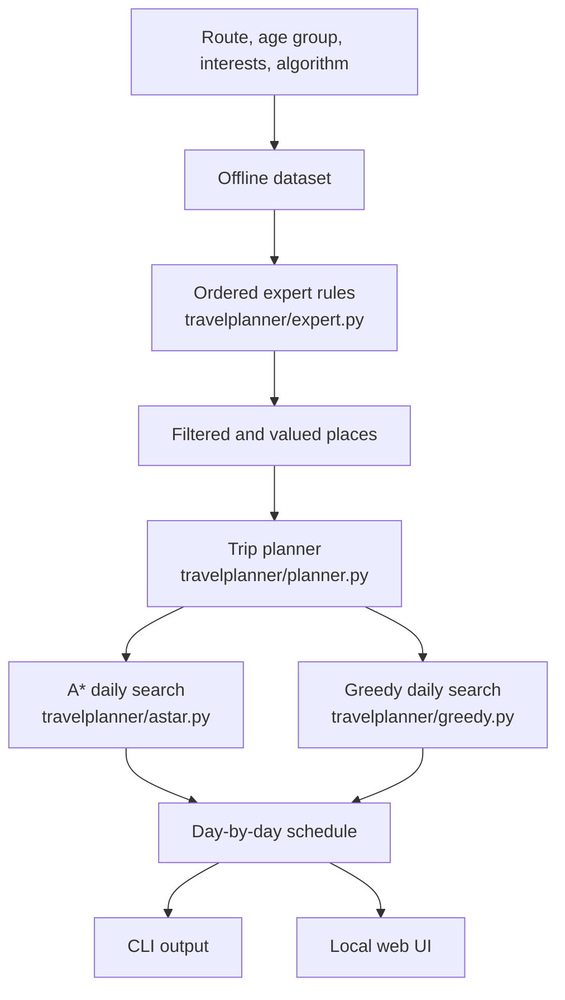

# 🗾 Tabi-Planner (旅プランナー)

[](https://www.python.org/)
[](LICENSE)
[](https://github.com/mughal-scri/Tabi-Planner/actions/workflows/tests.yml)
[]()

**Tabi-Planner** is an offline Japan travel itinerary planner. It combines an ordered expert-rule system with A* and Greedy search to build personalized day plans across multiple cities.

Choose a route, traveller age group, and interests. The planner considers estimated place value, visit duration, opening windows, and straight-line travel times. It runs locally without external APIs or an internet connection.

---

## 🌟 Key Features

- **🧠 Traveller-specific expert rules**
  - Sets daily planning windows by age group and adjusts senior travel time.
  - Excludes high-effort places for senior travellers.
  - Adds value for selected interests and souvenir scores.

- **🔍 Daily itinerary search**
  - **A\*** maximizes estimated place value using an optimistic fractional-knapsack bound.
  - **Greedy** provides a faster baseline for comparison.
  - Both account for opening windows, visit duration, travel estimates, and daily time limits.

- **🚄 Ordered multi-city routes**
  - Plan routes such as `tokyo:3,kyoto:2,osaka:1`.
  - Estimates transfers between cities and tracks visits across days.
  - Reports places that were not scheduled and rule-based removal reasons.

- **🌐 Local web application**
  - Three steps: route builder, interest selection, and itinerary view.
  - Uses vanilla HTML, CSS, and JavaScript with a Python standard-library HTTP server.

- **💻 Command-line interface**
  - Supports single-city and multi-city routes, selectable algorithms, and custom datasets.

- **📊 Offline dataset**
  - 12 cities and 135 places, with estimated coordinates, planning-hour windows, durations, categories, tags, and souvenir ratings.
  - The dataset is owner-supplied and unverified. Confirm current details before relying on a plan.

---

## 📐 Architecture & Planning Pipeline



The expert system runs these six rules once, in order: **R1** sets the daily window, **R2** filters high-effort places for seniors, **R3** sets the travel factor, **R5** adds the souvenir bonus, **R6** adds the interest bonus, and **R4** removes places that do not fit the window. This is a single ordered rule pass, not repeated forward chaining to a fixed point.

### Planning values and limits

- Daily windows start at 09:00: youth 10 hours, adult 8 hours, senior 6 hours. Senior travel time is multiplied by 1.3.
- Base place value is `attraction + souvenir`. A souvenir score of 3 or higher adds 2; a match to a selected interest adds 8. Interests match the place category or one of its tags.
- A* ranks states by `value so far + optimistic remaining value`. Its fractional-knapsack bound ignores travel time, so it can overestimate remaining value while preserving an upper bound.
- A* considers up to 20 candidates per day by default. If more remain, it searches the top 20 by value per duration and marks that day's result approximate.
- The planner schedules days in route order, one at a time. The total value across multiple days is not guaranteed to be globally optimal.
- Local movement uses straight-line Haversine distance at a fixed 20 km/h. Inter-city transfers use straight-line distance at 150 km/h plus a 30-minute buffer. These are rough estimates and do not model transit routes, closures, holidays, meal breaks, or a budget.
- Additional JSON fields such as admission fees, best seasons, and hours status are not currently loaded or used by the planner.

---

## 🚀 Quick Start

### Requirements

- Python 3.10 or newer

### Install

```bash
git clone https://github.com/mughal-scri/Tabi-Planner.git
cd Tabi-Planner
python3 -m venv .venv
source .venv/bin/activate  # Windows: .venv\Scripts\activate
python -m pip install -r requirements.txt
```

---

## 🖥️ Usage

### Web application

Start the local server:

```bash
python -m travelplanner.server
```

Open <http://127.0.0.1:8000>. You can also choose a port with `--port`:

```bash
python -m travelplanner.server --port 8080
```

### Command line

Plan a three-day adult trip to Tokyo:

```bash
python -m travelplanner.cli --city tokyo --days 3 --age adult
```

Plan an ordered Tokyo and Kyoto route:

```bash
python -m travelplanner.cli --route tokyo:3,kyoto:2 --age adult
```

Prioritize temples, gardens, and markets:

```bash
python -m travelplanner.cli --city kyoto --days 2 --age senior --interests temple,garden,market
```

Choose the search algorithm:

```bash
python -m travelplanner.cli --city osaka --days 2 --age youth --algorithm astar
python -m travelplanner.cli --city osaka --days 2 --age youth --algorithm greedy
```

### CLI options

| Argument | Description | Required / Default |
|---|---|---|
| `--city` | One city identifier | Mutually exclusive with `--route` |
| `--days` | Number of days; used with `--city` | Required with `--city` |
| `--route` | Comma-separated `city:days` entries | Mutually exclusive with `--city` |
| `--age` | `youth`, `adult`, or `senior` | Required |
| `--interests` | Comma-separated category IDs | Optional |
| `--algorithm` | `astar` or `greedy` | `astar` |
| `--data` | Dataset JSON path | `data/japan_travel_dataset.json` |

---

## 🧪 Tests

Run the test suite with:

```bash
python -m pytest -q
```

GitHub Actions runs the suite on pushes and pull requests. Tests cover search, expert rules, planning, dataset validation, CLI behavior, and the local server.

---

## 📁 Repository Structure

```text
Tabi-Planner/
├── data/
│   └── japan_travel_dataset.json
├── travelplanner/
│   ├── astar.py       # A* daily search
│   ├── cli.py         # Command-line interface
│   ├── config.py      # Planner settings
│   ├── expert.py      # Ordered expert-rule pass
│   ├── greedy.py      # Greedy search baseline
│   ├── knowledge.py   # Dataset loading and distance helpers
│   ├── models.py      # Dataclass models
│   ├── planner.py     # Multi-day and multi-city planning
│   └── server.py      # Local HTTP server and JSON API
├── web/               # Browser interface
├── tests/             # Pytest suite
├── .github/workflows/ # Continuous integration
├── requirements.txt
└── LICENSE
```

## 📄 License

This project is licensed under the [MIT License](LICENSE).
