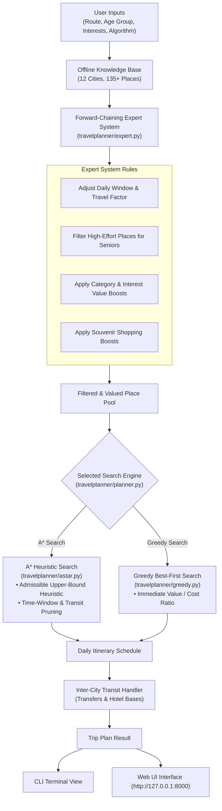

# 🗾 Tabi-Planner (旅プランナー)

[](https://www.python.org/)
[](LICENSE)
[]()
[]()

**Tabi-Planner** is an offline-first, AI-driven Japan travel itinerary planner. It combines a **Forward-Chaining Expert System** with **Heuristic Search (A\* and Greedy Search)** to build optimal, personalized multi-day and multi-city travel itineraries across Japan.

Whether planning a weekend exploration in Tokyo or a comprehensive multi-city expedition across Kyoto, Osaka, and Hiroshima, Tabi-Planner tailors each day's schedule to the traveller's age profile, walking pace, preferred attractions, and opening hour constraints—all without requiring an internet connection or external API keys.

---

## 🌟 Key Features

- **🧠 Forward-Chaining Expert System**
  - Dynamically adapts daily planning windows and schedules based on traveller age groups (`youth`, `adult`, `senior`).
  - Enforces physical effort limits (e.g., auto-filtering high-exertion sites for seniors).
  - Applies age-specific transit pace factors and fatigue thresholds.
  - Dynamically boosts place utility based on user interest categories and souvenir shopping preferences.

- **🔍 Intelligent Itinerary Search (A\* & Greedy)**
  - **A\* Search**: Uses an admissible heuristic that upper-bounds reachable place value to find high-value daily schedules.
  - **Greedy Best-First Baseline**: Fast heuristic search for benchmark comparison.
  - Respects real-world constraints: operating hours, visit durations, inter-attraction transit times via Haversine distance calculations, and daily time limits.

- **🚄 Multi-City Route Planning**
  - Build multi-day itineraries across ordered routes (e.g. `tokyo:3,kyoto:2,osaka:1`).
  - Seamless inter-city transfers scheduled between destination transitions.
  - Tracks visited locations across days to avoid repeat visits while surfacing unscheduled places with reason codes.

- **🌐 Interactive Local Web Application**
  - Intuitive 3-step planning wizard: Route Builder ➔ Interest Selection ➔ Visual Day-by-Day Timeline.
  - Interactive interest bubbles with visual toggles.
  - Grouped city itineraries with arrival transfer banners, visit durations, and opening windows.
  - Zero front-end build tools needed: vanilla HTML5, modern CSS, and JavaScript served by a lightweight Python standard library HTTP server.

- **💻 Flexible CLI Tool**
  - Fully featured command-line interface for terminal users, scripting, and pipeline integration.
  - Supports custom datasets, algorithm selection (`--algorithm astar` vs `--algorithm greedy`), and route definitions.

- **📊 Comprehensive Offline Dataset**
  - **12 Japanese Cities**: Tokyo, Kyoto, Osaka, Nara, Hiroshima, Sapporo, Fukuoka, Yokohama, Kanazawa, Nagoya, Nagasaki, and Takayama.
  - **135+ Places of Interest**: Curated with coordinates, opening hours, estimated duration, cost, category tags, and souvenir ratings.

---

## 📐 Architecture & Pipeline



---

## 🚀 Quick Start

### Prerequisites

- **Python 3.10** or higher

### Installation

1. **Clone the repository:**
   ```bash
   git clone https://github.com/abdullahmughal/Tabi-Planner.git
   cd Tabi-Planner
   ```

2. **Create and activate a virtual environment:**
   ```bash
   python3 -m venv .venv
   source .venv/bin/activate  # On Windows: .venv\Scripts\activate
   ```

3. **Install dependencies:**
   ```bash
   pip install -r requirements.txt
   ```

---

## 🖥️ Usage

### 1. Interactive Web Application

Launch the local web server:

```bash
python -m travelplanner.server
```

Open your browser and navigate to:
```
http://127.0.0.1:8000
```

- **Step 1:** Select your cities, days per city, and your traveller age group.
- **Step 2:** Click to activate interest bubbles (e.g. *Temples*, *Markets*, *Gardens*, *Architecture*).
- **Step 3:** Click **"Plan your trip"** to view your daily schedule with stop times, transfer alerts, and estimated values.

To run on a custom port:
```bash
python -m travelplanner.server --port 8080
```

---

### 2. Command Line Interface (CLI)

#### Single City Itinerary
Plan a 3-day adult trip to Tokyo:
```bash
python -m travelplanner.cli --city tokyo --days 3 --age adult
```

#### Multi-City Route
Plan a 5-day route covering Tokyo (3 days) and Kyoto (2 days):
```bash
python -m travelplanner.cli --route tokyo:3,kyoto:2 --age adult
```

#### Targeting Specific Interests
Prioritize temples, gardens, and markets:
```bash
python -m travelplanner.cli --city kyoto --days 2 --age senior --interests temple,garden,market
```

#### Selecting Search Algorithm
Compare itineraries between **A\*** and the **Greedy** baseline:
```bash
# Optimal A* search (default)
python -m travelplanner.cli --city osaka --days 2 --age youth --algorithm astar

# Greedy best-first search baseline
python -m travelplanner.cli --city osaka --days 2 --age youth --algorithm greedy
```

#### CLI Options Reference

| Argument | Description | Required / Default |
|---|---|---|
| `--city` | Single city identifier (e.g., `tokyo`, `kyoto`) | Mutually exclusive with `--route` |
| `--days` | Number of days (used with `--city`) | Required if `--city` is specified |
| `--route` | Comma-separated `city:days` list (e.g., `tokyo:3,kyoto:2`) | Mutually exclusive with `--city` |
| `--age` | Traveller age group: `youth`, `adult`, or `senior` | **Required** |
| `--interests` | Comma-separated interest category IDs | Optional (`""`) |
| `--algorithm` | Search algorithm: `astar` or `greedy` | Default: `astar` |
| `--data` | Custom path to dataset JSON | Default: `data/japan_travel_dataset.json` |

---

## 🧠 AI & Algorithm Implementation Details

### Forward-Chaining Expert System (`travelplanner/expert.py`)
The expert engine operates on a working memory of facts and repeatedly executes rule activations until reaching a fixed point:
- **Rule 1 (Daily Window & Pacing):** Assigns operating hours based on traveller endurance (`youth`: 10h, `adult`: 9h, `senior`: 7h) and calibrates travel time multipliers.
- **Rule 2 (Physical Exertion Filter):** Protects senior travellers by removing high-effort walking places (e.g., steep mountain temples or sprawling complexes) from candidate pools.
- **Rule 3 (Interest Value Boost):** Elevates place values matching user-selected category interests (+20 value bonus).
- **Rule 4 (Souvenir Preference Boost):** Rewards places offering cultural shopping or local specialties (+15 value bonus).

### A* Search Algorithm (`travelplanner/astar.py`)
- **State Representation:** `(current_place, current_time, visited_places, accumulated_score)`
- **Cost Function $g(n)$:** Elapsed time including transit duration (Haversine calculation at calibrated walking speeds) and place visit durations.
- **Heuristic Function $h(n)$:** An admissible upper-bound estimate that calculates the maximum potential score achievable in the remaining daily window, ensuring search completeness and optimality.
- **Time-Window Pruning:** Automatically discards states that would arrive after attraction closing hours or exceed the traveller's daily time limit.

---

## 🧪 Testing

The project includes a comprehensive test suite covering the expert system, search heuristics, data integrity, CLI parsing, and HTTP server endpoints.

Run all tests with:
```bash
pytest -q
```

Output:
```text
============================= 125 passed in 5.3s =============================
```

### Test Suite Structure
- `tests/test_expert.py`: Validates forward-chaining rule deductions and age profile constraints.
- `tests/test_astar.py`: Tests A* optimality, constraint pruning, and heuristic admissibility.
- `tests/test_greedy.py`: Tests greedy algorithm decisions and benchmark comparisons.
- `tests/test_planner.py`: Multi-day route planning, transfers, and state tracking.
- `tests/test_cli.py`: CLI arguments, flag validation, and terminal formatting.
- `tests/test_server.py`: API endpoint response contracts and static asset delivery.
- `tests/test_knowledge.py`: Dataset schema validation, coordinates, and Haversine math.
- `tests/test_models_config.py`: Pydantic model validation and default configurations.

---

## 📁 Repository Structure

```text
Tabi-Planner/
├── data/
│   └── japan_travel_dataset.json  # 12 cities, 135+ attractions offline dataset
├── travelplanner/
│   ├── __init__.py                # Package declaration
│   ├── astar.py                   # A* search algorithm with admissible heuristic
│   ├── cli.py                     # Command-line interface
│   ├── config.py                  # Default constants, pace, and rule limits
│   ├── expert.py                  # Forward-chaining expert rule system
│   ├── greedy.py                  # Greedy best-first search baseline
│   ├── knowledge.py               # Dataset loader, Haversine geo calculations
│   ├── models.py                  # Pydantic data models
│   ├── planner.py                 # Multi-day and multi-city planning pipeline
│   └── server.py                  # Local Python HTTP server & JSON API
├── web/
│   ├── index.html                 # Web UI single-page application
│   ├── styles.css                 # Web application styling
│   └── app.js                     # Web application UI logic
├── tests/                         # Full Pytest test suite (125 tests)
├── pytest.ini                     # Pytest configuration
├── requirements.txt               # Python dependencies
├── LICENSE                        # MIT License
└── README.md                      # Project guide and overview
```

---

## 📄 License

This project is open-source and licensed under the [MIT License](LICENSE).
